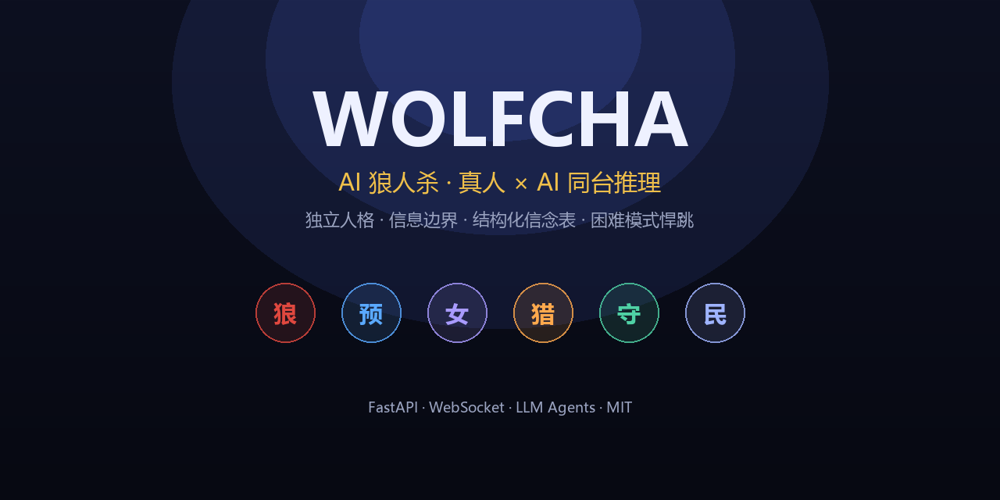
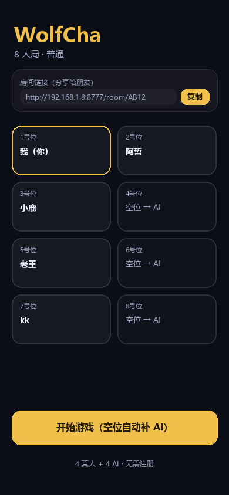
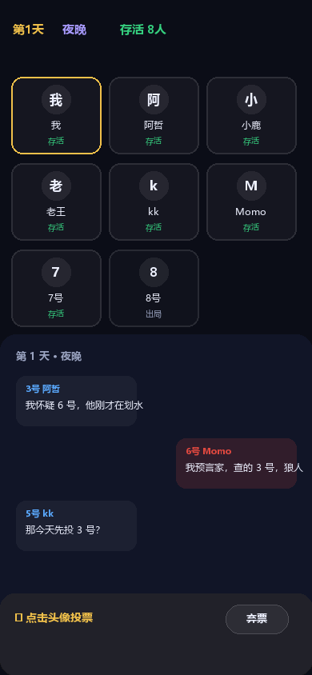
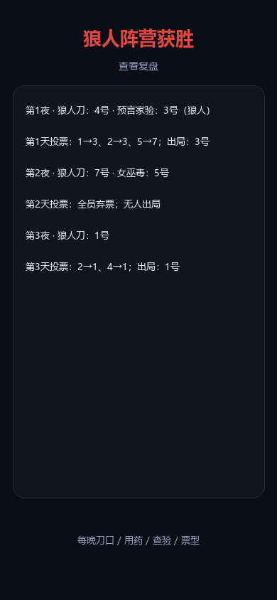

# Wolfcha · AI 狼人杀

> LLM 驱动的多人社交推理游戏：**真人坐满一半，AI 补上另一半**。
> 不用凑人、不用法官，打开网页就能开局。

[](https://www.python.org/)
[](https://fastapi.tiangolo.com/)
[](LICENSE)
[](#贡献)



---

## 这是什么

一个跑在浏览器里的狼人杀。几个真人用手机进同一个房间，剩下的座位由大模型 AI 补齐——

- AI 有**独立人格**：8 种性格原型，随机分配，有人话痨、有人慢热、有人阴阳怪气；
- AI 有**信息边界**：只知道自己的身份、技能结果和公开信息，看不到别人的底牌；
- AI 会**盘逻辑**：结构化信念表记录每一夜的查验、票型和身份宣称，投票跟着自己的发言走；
- AI 有**难度梯度**：困难模式会悍跳预言家、给队友发金水、分票、刀跳出来的神职。

一局 8 人（4 真人 + 4 AI）大概几十次模型调用，成本几分钱。

## 界面预览

<p align="center">
  
  
  
</p>

> 图为界面示意（按实际配色与布局绘制），实机效果以运行版本为准。

## 特性

| | |
|---|---|
| **多人同房** | 建房 → 分享链接 → 手机入座，空位自动补 AI，无需注册 |
| **AI 玩家** | 人格原型 + 板子感知 + 信念表 + 关键节点反思 |
| **难度** | 简单 / 普通 / 困难，困难档有悍跳、倒钩、分票、刀神等战术 |
| **规则** | 8～12 人固定板子、屠边胜负、同守同救必死、猎人夜枪、多数票出局、弃票 |
| **移动端** | 竖屏布局、点头像投票、快捷发言、玩家标记、逐字显示带停顿 |
| **复盘** | 每晚刀口 / 用药 / 查验 / 每轮票型，结算页一键展开 |
| **成本** | 批量生成性格、选择性反思、上下文截断，单局成本压到最低 |

## 架构

```
  手机 / 浏览器
       │  WebSocket + HTTP
       ▼
  FastAPI 服务（房间、座位、事件广播）
       │
       ▼
  GameController（流程调度 + 规则判定）
       │
       ├── Agent 决策层（人格 / 记忆 / 信息过滤 / 策略）
       │        │
       │        ▼
       │   LLM API（DeepSeek / 通义 / 任意 OpenAI 兼容端点）
       │
       └── 事件总线 → 公共事件广播 / 私密事件单播
```

关键设计：

- **信息隔离**：夜间私密消息（狼刀、查验、女巫用药）按 `visibility_type` 过滤，绝不会进入其他玩家的上下文；
- **信念表**：每轮把存活、死讯、身份宣称、票型、按夜查验压成结构化事实，代替让模型读长文本；
- **选择性反思**：只在出局、投票、查验等关键节点触发，每次最多 2 个 AI，兼顾连贯性与成本。

## 快速开始

```bash
git clone https://github.com/yuchou1021/wolfcha.git
cd wolfcha
pip install -r requirements.txt
cp .env.example .env       # 填入模型 key
python main.py
```

打开 `http://localhost:8777`。同一局域网的手机访问 `http://<你的内网IP>:8777`。

Windows 也可以直接双击 `启动.bat`，会自动打印手机访问地址。

## 配置

```env
DEEPSEEK_API_KEY=sk-your-key
DEEPSEEK_API_BASE=https://api.deepseek.com
DEEPSEEK_MODEL=deepseek-chat
```

支持任意 OpenAI 兼容接口。`llms_config/` 下可以为不同模型预设参数。

> `.env` 已被 `.gitignore` 忽略。**不要提交真实 key**；若曾泄露，请立即在模型后台重置。

## 玩法

1. 第一个人选人数、创建房间，把链接发到群里；
2. 其他人点链接，填名字、选座位；
3. 留出空位，房主点「开始游戏」，空位自动变 AI；
4. 白天按序发言、投票，夜里各自行动，直到一方达成胜利条件。

## 项目结构

```
main.py              FastAPI 服务、房间与 WebSocket
game_controller.py   游戏流程与规则判定
agent/               决策、记忆、信息过滤、策略库
game/phases/         各阶段 prompt 构建
roles/               角色策略与人格素材
static/              移动端前端
llms_config/         模型预设
```

## Roadmap

- [ ] V2：基于 [Wolfcha](https://github.com/oil-oil/wolfcha) 引擎的多人联机版（房间中继 + 私密视图）
- [ ] 更多角色：白狼王、骑士、狼美人
- [ ] 语音发言与 TTS
- [ ] 对局回放与数据统计

## 贡献

欢迎 Issue 和 PR。提交前请确认：

- 没有把 `.env`、真实 key、日志带进提交；
- 规则改动附上对应场景说明（例如“同守同救”的判定）；
- 前端改动在手机宽度下自测过。

## 致谢

- 原始项目：[AgentWereWolf](https://github.com/yingyingxia666/AgentWereWolf)（MIT）
- 角色图标：[game-icons.net](https://game-icons.net)（CC BY 3.0）
- 灵感与对标：[Wolfcha](https://github.com/oil-oil/wolfcha)

## License

[MIT](LICENSE)
